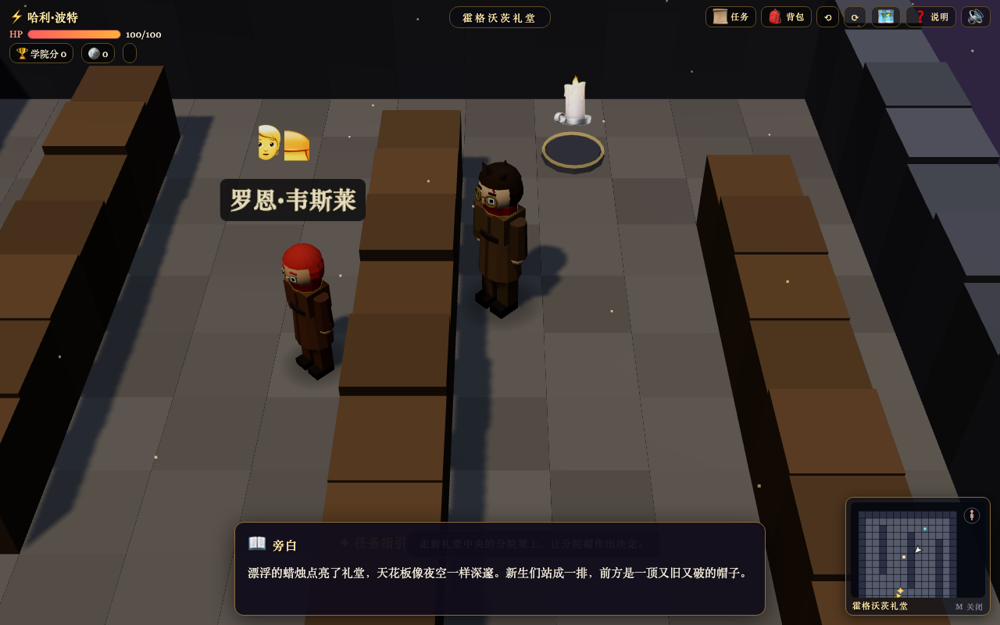

# 哈利·波特与魔法石 · 3D 角色扮演冒险

> 一个用 **Three.js** 从零搭出来的纯前端 3D 小游戏：从女贞路 4 号的一封神秘来信开始，
> 走到对角巷买魔杖、在霍格沃茨礼堂分院、穿过三头犬把守的地下走廊，最后阻止奇洛教授盗走魔法石。




**没有任何美术资源** —— 场景、角色、道具全部由代码程序化生成，音效用 Web Audio API 实时合成。
整个项目就是 `index.html` + 三个 JS 文件，拉下来双击就能玩。

🎮 **在线试玩**：https://fenglin-ai.github.io/harry-potter-3d-rpg/

---

## ✨ 特性

| 模块 | 说明 |
| --- | --- |
| 11 张手绘关卡地图 | 女贞路 → 对角巷 → 国王十字 9¾ 站台 → 霍格沃茨特快 → 礼堂 / 城堡 / 教室 / 魁地奇球场 → 禁林 → 厄里斯魔镜 → 地下走廊 |
| 真 3D 场景 | Three.js 低多边形程序化建模，几何体合并优化，跟随式轨道相机 |
| 关节式角色 | 髋部 / 肩部独立转轴的骨骼结构，走路摆臂摆腿；五官逐件建模（眼眶 + 眼白 + 虹膜 + 瞳孔 + 高光 + 眉 + 鼻 + 嘴），长袍收摆配腰带、露裤腿皮鞋 |
| 视角自由 | Q / R 每次旋转 30°，鼠标拖拽自由环视，滚轮缩放 |
| 任务与对话 | 主线任务串起 11 张地图，NPC 对话带分支与剧情推进 |
| 8 个迷你游戏 | 魔咒课（节奏条）、三头犬（吹笛）、魔鬼网、会飞的钥匙、活人棋局、魔药谜题、斯内普提问、魁地奇抓飞贼 |
| 剧情题随机 | 题目与选项每次进入都重新洗牌，判分仍按原始下标，重复玩不会背答案 |
| 《魔法石》版哈利 | 主角是一年级新生体型：头身比更大、圆脸蛋、小圆鼻、蓝眼睛，配标志性圆黑框眼镜、永远梳不趴的乱毛和额头闪电疤。罗恩、赫敏、纳威、马尔福同样按小孩体型建，师生保持成人比例 |
| 一头乱毛（顶点抖动） | 头发是球壳顶点沿法线随机外推出来的，不是「光滑球 + 外面粘一堆小球」——后者要么被球壳吞掉（后脑像秃的），要么全鼓出来变成一串葡萄 |
| 海格是混血巨人 | 身高约为哈利的 2.1 倍，一身毛由领口 / 前襟 / 下摆 / 双袖口的毛球圈拼成；赫敏是一头垂到肩下的长发 |
| 树不再悬空 | 树所在瓦片原本不铺地板，底下是个深坑；现在每棵树都坐在草顶泥壁的土丘上，周围一圈草，树干 40–54 高 |
| 装备有属性 | 长袍 / 课本 / 海德薇 / 邓布利多卡 / 木笛 / 光轮2000 / 古灵阁钥匙 / 魔法石 都带战斗加成（攻击·命中·减伤·体力上限），背包里能直接看到，奇洛决战里真的生效 |
| 背包 / 学院分 / 金币 | 道具收集与使用，学院分在剧情中结算 |
| 小地图 | 跟随视角旋转、带指北针、任务目标超出视野时贴边指示 |
| 实时合成 BGM | C 大调八小节三拍子循环（C–Am–F–G），音乐盒音色（非整数泛音）+ 弦垫 + 延迟回声大厅感 |
| 存档 | localStorage 自动存档，标题页「继续冒险」 |
| 手机适配 | 虚拟方向键 + 互动按钮，窄屏 HUD 自动收缩 |

## ⌨️ 操作

| 按键 | 作用 |
| --- | --- |
| `W` `A` `S` `D` / 方向键 | 移动（方向随当前视角自动换算） |
| `E` / `空格` | 互动、推进对话 |
| `Q` / `R` | 旋转视角（每次 30°） |
| 鼠标拖拽 / 滚轮 | 自由环视 / 缩放 |
| `T` | 任务指引 |
| `B` | 背包 |
| `M` | 小地图开关 |
| `H` | 操作说明 |
| `Esc` | 关闭面板 / 跳过迷你游戏 |

手机端：左下虚拟方向键移动，右下大按钮互动，右上角按钮组与左上角小地图。

## 🚀 本地运行

```bash
git clone https://github.com/fenglin-ai/harry-potter-3d-rpg.git
cd harry-potter-3d-rpg

# 任选一种起服务（推荐，避免个别浏览器的 file:// 限制）
python3 -m http.server 8000
# 然后打开 http://localhost:8000
```

也可以直接双击 `index.html`（所有依赖都是本地相对路径，不需要联网、不需要构建、没有 CDN）。

浏览器要求：支持 WebGL 的现代浏览器（Chrome / Edge / Firefox / Safari）。

## 🧱 目录结构

```
.
├── index.html              # 页面骨架 + HUD / 面板 DOM
├── css/style.css           # 全部样式（含手机端媒体查询）
├── js/
│   ├── data.js             # 数据层：11 张地图、NPC、道具、对话、任务、迷你游戏配置
│   ├── render3d.js         # 渲染层：Three.js 引擎（建模 / 光照 / 相机 / 精灵）
│   ├── game.js             # 逻辑层：输入、状态机、任务、对话、迷你游戏、存档、小地图
│   ├── vendor/three.min.js # Three.js r160（MIT，内置不依赖 CDN）
│   └── __smoke.js / __smoke3d.js / __flow.js   # 无头测试脚本
├── docs/                   # README 截图
├── LICENSE                 # MIT
└── THIRD-PARTY-NOTICES.md  # 第三方依赖与协议
```

### 渲染层做了什么

- **程序化建模**：盒子 / 圆柱 / 球 / 锥体拼出房屋、树、火把、城堡、书柜等；按瓦片哈希做轻微色差，避免大片纯色
- **几何体合并**：成百上千个方块合并成单个 `Mesh`，保证低端设备也能跑满帧
- **顶点法线着色**：按法线 Y 分量区分顶面 / 侧面 / 底面，一个材质就能出体积感
- **光照**：`AMBIENT` 表为每张地图配置 sky / fog / 太阳 / 半球光 / 补光；地下走廊、禁林这类黑暗地图整体压暗，并给玩家一个微弱的随身光晕
- **CanvasTexture 精灵**：NPC 名字、道具图标、任务 ✦ 标记、地面 blob 阴影都是运行时画出来的贴图
- **相机**：偏航角 + 俯角 + 距离的轨道式跟随相机，WASD 用 90° 量化后的基向量换算，保证任意视角下单键移动都严格沿瓦片轴走（不会斜着撞墙）
- **角色骨架**：`joint()` 把旋转轴放在髋部 / 肩部，四肢绕关节摆动而不是绕身体中心平移；人马、三头犬复用同一套五官函数，脸朝 -Z 时自动镜像

### 音频

背景音乐与全部音效都由 Web Audio API 实时合成，没有一个音频文件：

- **BGM**：`BEAT = 0.42s` 的三拍子（约 143 BPM），8 小节循环走 C–Am–F–G 的经典走向 —— 大调明亮、适合儿童，同时靠钢片琴音色和延迟回声撑起「魔法感」
- **钢片琴 / 音乐盒音色**：`bell()` 叠 4 个**非整数倍**泛音（`1 / 2.01 / 3.03 / 4.97`）并让高次泛音快速衰减，模拟真实金属棒的非谐性
- **弦乐垫底**：`padChord()` 三个音各自微失谐 ±6 音分，慢起慢落，制造合唱般的厚度
- **回声**：音乐总线上挂 `DelayNode(0.34s)` 反馈环（反馈量 0.26）+ 2.4kHz 低通，做出大厅残响但不会糊成一团

## 🧪 测试

三套 Node 无头测试，用 `vm` 把三个 JS 合并加载、桩掉 DOM 与 `WebGLRenderer`，跑纯逻辑断言：

```bash
node js/__smoke.js      # 219 项：数据完整性、相机/节点、小地图、操作说明、背景音乐、选项随机、决战收尾、装备属性
node js/__smoke3d.js    # 80 项：Three.js 真实几何路径、旋转、缩放、小孩体型比例、乱发/巨人/长发/树
node js/__flow.js       # 122 项：沿地图实际走一遍验证流程可通关（含三头犬节奏、奇洛决战）
```

合计 **421 项断言全绿**。

新增的关键用例都做过**反向验证**：把修复临时改回旧写法，新测试必须报错才行。

- 删掉 `MINIS.duel` → 9 项 FAIL（复现「决战点了没反应」）
- 去掉 NPC 的 `show` 收尾条件 → 同上 FAIL（复现「打赢了还能反复打」）
- 把节奏判定改回 `phase <= 0.24` → 4 项 FAIL，其中一条正是 `按在节拍上没有掉血 (100 → 52)`（复现「跟着提示按却还是掉血」）

体型这块也做过同样的反向验证：把头部放大系数误用到躯干上 → 2 项 FAIL（`小孩的躯干更窄，不是更宽 (1.114 vs 1.000)`）；
学生退回成人比例 → 1 项 FAIL；镜片半径调过头 → 2 项 FAIL（`两环不重叠`）；
小孩的头不放大 → 4 项 FAIL；疤痕不分角色给 → 1 项 FAIL（`其他小孩没有闪电疤`）。

第七轮同样逐条反向验证过：
头发壳不做顶点抖动 → 1 项 FAIL（`发壳表面有明显起伏 (0.00)`）；抖动改成里外双向 → 1 项 FAIL（`最小半径 5.88`，会露出头皮）；
虹膜放大回铺满眼眶 → 1 项 FAIL；高光挪回眼白上 → 1 项 FAIL（`高光落在虹膜上`）；
海格退回 1.32 → 1 项 FAIL（`1.44 倍`）；毛改回大方块 → 1 项 FAIL；长发改回方块 → 2 项 FAIL；
树干退回 22 高 → 1 项 FAIL；**删掉树坑土丘 → 2 项 FAIL**（这条断言一开始只认 `y=5`，被别的地图构件蒙过去了，改成「格子中心 + `y=-12`」才真正咬住）；
装备：长袍去掉 `stat` → 2 项 FAIL；重复物品改成叠加 → 1 项 FAIL；体力上限不按比例迁移 → 1 项 FAIL（`50/100 → 112/112`）；
攻击不乘装备 → 1 项 FAIL；减伤去掉 40% 下限 → 1 项 FAIL；把 `0.15` 写成 `15` → 2 项 FAIL；背包不渲染属性 → 1 项 FAIL。

其中音乐测试用**记录型 AudioContext 桩**跑：不真的出声，而是记下每个振荡器频率与增益包络峰值，再断言
「8 小节循环 / 每小节 3 拍 3 和弦音 / 开头是 C 大三和弦 / 包络峰值足够 / 信号一路连到 destination」——
这样即使在没有声卡的 CI 环境里，也能抓到「代码跑通了但其实是静音」这类 bug。

## 📄 开源协议

代码采用 **[MIT License](LICENSE)**，可自由使用、修改、二次分发（含商用），只需保留署名。

第三方依赖见 [THIRD-PARTY-NOTICES.md](THIRD-PARTY-NOTICES.md)：
仅内置了 [Three.js](https://github.com/mrdoob/three.js) r160（MIT）。

---

## ⚠️ 免责声明

本项目是**粉丝向的非商业学习项目**，用于练习前端 3D 渲染与游戏逻辑实现。

- 「哈利·波特」系列的角色、地点、故事与相关名称的著作权与商标权归
  **J.K. Rowling 与 Warner Bros. Entertainment Inc.** 所有，本项目不主张任何权利，也不用于任何商业用途。
- MIT 协议**仅覆盖本项目自身的代码**；不含任何官方素材 ——
  所有美术表现均由代码程序化生成，音效由 Web Audio API 实时合成，未使用任何官方图片、音频、字体或模型。
- 如权利方认为本项目存在不妥，请通过 GitHub Issues 联系，我会第一时间下架相关内容。
